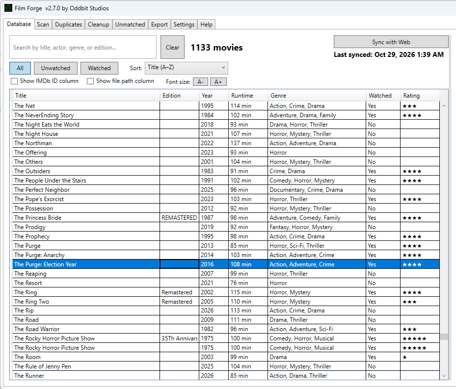
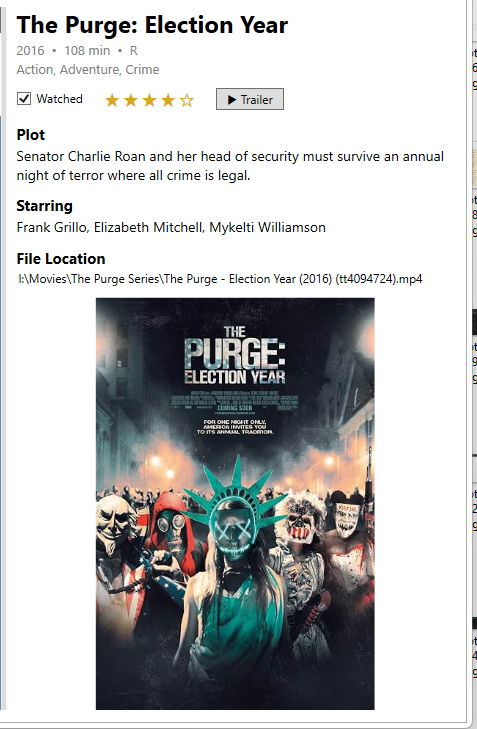

# Film Forge

Film Forge is a free Windows app that catalogs your personal movie library. Point it at the folders where your movie files live, and it figures out what each file is, looks up the details online, and builds a searchable database of your collection. It's built for people with big libraries, including multiple editions of the same film, and everything is stored on your own computer.

Made by [Oddbit Studios](https://oddbitstudios.com).

## Download

Get **FilmForgeSetup.exe** from the [Releases page](https://github.com/oddbitstudios/film-forge/releases/latest) and run it.

Windows may show a blue "Windows protected your PC" screen the first time, because the installer isn't code-signed yet. Click **More info**, then **Run anyway**.

## What it does

Film Forge scans your folders for video files and reads each filename to work out the title, year, and IMDb ID. It then fetches the poster, plot, cast, and other details and saves everything in a local database. You can browse and search the whole collection, see every file and edition behind a movie, and mark movies as watched and rate them.

The app is organized into tabs:

**Scan** finds new video files in your folders and fetches their details.

**Database** is your searchable library. Click any column to sort, and select a movie to see its poster, plot, and details in the side panel. Each file is tracked separately, so different editions of the same movie each keep their own watched status and rating.

**Duplicates** and **All Duplicates** help you find movies you have more than once.

**Cleanup** checks that the files in your database still exist on disk and lets you remove records for files that are gone.

**Export** saves your library as a CSV file, an Excel spreadsheet, or a PDF with star ratings.

**Settings** controls your folders, your lookup key, the light or dark theme, and optional features.

## Naming your files

Film Forge works best when files are named like this:

`Title (YEAR) 'edition' (imdbid)`

For example: `Blade Runner (1982) 'Final Cut' (tt0083658)`

The year and IMDb ID help the app pick the right movie, and the edition note lets you keep several versions of one film. Files that don't follow this pattern are still matched as well as possible from their names.

## Requirements

Windows 10 or 11, 64-bit. Looking up movie details needs an internet connection and a free API key from [OMDb](https://www.omdbapi.com/apikey.aspx), which you enter in Settings.

## Your data

Your library is stored in a local SQLite database on your computer. Nothing is uploaded unless you turn on the optional web sync in Settings, which is off by default.

## Built with

C# and WPF on .NET 10, SQLite for the database, ClosedXML for Excel export, and QuestPDF for PDF export. Movie details come from OMDb.

## Support

If Film Forge is useful to you, you can [buy me a coffee](https://www.buymeacoffee.com/oddbitstudios). Questions or problems can be reported on the [Issues tab](https://github.com/oddbitstudios/film-forge/issues).
